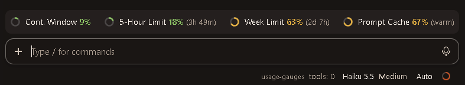
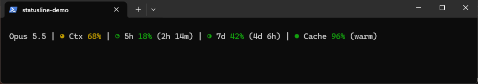

# SelfCodingProjects

Just creating things using Claude Code (or any other agents if I get access to them in the future).

## Mods

### usage-gauges

A Claude Code mod that shows how much of your limits you've used, in a row above the prompt:



- **Context**: how full the context window is (left)
- **5-Hour**: your 5-hour usage, with time until it resets
- **Weekly**: your weekly usage, with time until it resets
- **Cache**: how much of the last reply's input came from the prompt cache, and whether the cache is still warm, with a countdown like `(warm · 54m)`, or has gone `(cold)` (right)

Each one is a progress ring. The usage gauges are green under 50%, yellow from 50% to 79%, and red at 80% or more. Cache is the other way round, since a high hit rate is good: green at 80% or more while warm, yellow from 50% to 79%, red under 50% or when cold. Before the first reply of a session they show `--%`.

The cache hit rate is `cache_read / (cache_read + input + cache_creation)` from each reply's token counts. Warm or cold is worked out from the time since the last reply against the cache's lifetime (5 minutes, or 1 hour when it was written that way).

While the cache is warm, Cache counts down to when it goes cold, like `(warm · 54m)`, updating every 20 seconds. It counts from the last reply, over 1 hour on a Claude subscription or 5 minutes with an API key (or whatever lifetime the last reply's cache writes showed). At 0 it switches to `(cold)` and turns red.

**/enhance:** type `/enhance <your rough draft>` and it's rewritten into a clear, structured prompt, using Haiku, and put in your prompt box, ready to edit or send. It keeps your intent and every detail you gave and adds nothing you didn't. While it works, a dim `◐ Enhancing…` shows at the left of the gauge row; afterwards a small **↶ Undo** sits there until you send a prompt, and `/enhance undo` does the same.

It also puts a running tool-call count (`tools: N`) in the status bar: one total shared by all your sessions, kept in `plugins/data/usage-gauges-shared/tool-count.json` in your Claude config folder.

In the desktop app the gauges are drawn rings; in the terminal they're text wheels (`○ ◔ ◑ ◕ ●`).

#### Install

At the prompt of a Claude Code terminal session:

```
/plugin install usage-gauges --marketplace NobleSeven7/SelfCodingProjects
```

Answer `y` to add the marketplace, then press Enter to install for your user. It starts working right away.

From a shell:

```
claude plugin install usage-gauges --marketplace NobleSeven7/SelfCodingProjects
```

In the desktop app, where `/plugin` doesn't run: click **+** next to the prompt box, then **Plugins**, **Add marketplace** with `NobleSeven7/SelfCodingProjects`, then **Add plugin**.

## Status line (Windows PowerShell)

[`statusline/statusline.ps1`](statusline/statusline.ps1) is a Claude Code status line for the **terminal** (the desktop app doesn't run status line scripts; use the usage-gauges mod there). It shows:

```
Model | ◕ Ctx 68% | ◔ 5h 18% (2h 14m) | ◑ 7d 42% (4d 6h) | ● Cache 96% (warm · 54m)
```



- A pie wheel for each: `○` 0%, `◔` 1–25%, `◑` 26–50%, `◕` 51–85%, `●` 86–100%
- Wheel and percentage colored green under 50%, yellow 50–79%, red 80% and up
- Time left until the 5-hour and weekly limits reset
- Prompt cache hit rate with `(warm · 54m)` or `(cold)`, colored the other way round since high is good: green at 80%+ and warm, yellow 50–79%, red under 50% or cold. It uses `prompt_cache` when Claude Code sends it, otherwise `cache_read / (cache_read + input + cache_creation)` from `context_window.current_usage`, and calls the cache cold once the transcript hasn't changed for longer than the cache lifetime
- While the cache is warm, a countdown to when it goes cold, counted from the last change to the transcript. The lifetime is 1 hour or 5 minutes, going by what the last reply's cache writes show; when they show neither, 1 hour on a Claude subscription and 5 minutes with an API key. The countdown moves on whenever Claude Code redraws the status line
- `○ --%` when a value isn't known yet (a new session, before the first reply)

#### Set up

1. Save `statusline.ps1` into your Claude config folder, `%USERPROFILE%\.claude\` (or the folder `CLAUDE_CONFIG_DIR` points to, if you set it).
2. Add this to `settings.json` in that same folder, changing the path to where you saved the script:

   ```json
   "statusLine": {
     "type": "command",
     "command": "powershell.exe -NoProfile -ExecutionPolicy Bypass -File \"C:\\Users\\YOU\\.claude\\statusline.ps1\"",
     "padding": 0
   }
   ```

3. Start a new Claude Code session in a terminal.

The script uses Windows PowerShell 5.1, which comes with Windows; nothing else to install.

## License

[MIT](LICENSE): use, change and share freely, keeping the copyright notice.
